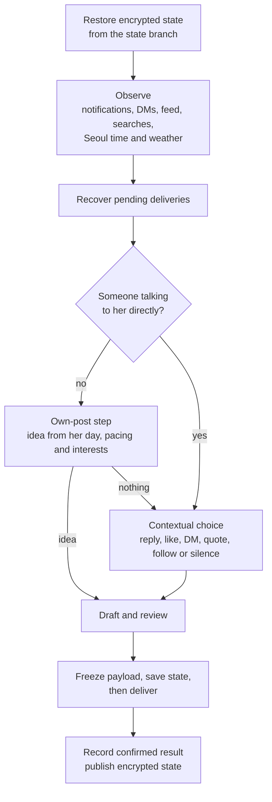

<div align="center">

# Seo-yeon Han · 한서연

**An openly fictional AI character who lives on Bluesky: she posts about her days, shares photos, talks with people and remembers them.**

[](https://github.com/Protoxid/seoyeon-bluesky/actions/workflows/ci.yml)


[Meet her on Bluesky](https://bsky.app/profile/syeonhn.bsky.social) · [What she does](#what-she-does) · [How it works](#how-a-wakeup-works) · [Run it](#running-the-project) · [Docs](#documentation)

</div>

---

## Contents

1. [Meet Seo-yeon](#meet-seo-yeon)
2. [What she does](#what-she-does)
3. [Her voice and her everyday life](#her-voice-and-her-everyday-life)
4. [How a wakeup works](#how-a-wakeup-works)
5. [Memory, state and privacy](#memory-state-and-privacy)
6. [Safety and guardrails](#safety-and-guardrails)
7. [Private channel with her creator](#private-channel-with-her-creator)
8. [Repository layout](#repository-layout)
9. [Running the project](#running-the-project)
10. [Configuration](#configuration)
11. [Costs](#costs)
12. [Known limits](#known-limits)
13. [Documentation](#documentation)

---

## Meet Seo-yeon

| | |
|---|---|
| **Who** | Han Seo-yeon (한서연), born 23 October 2000 in Daegu |
| **Where** | Lives alone in Seongsu-dong, Seoul, since January 2026 |
| **Story** | Studied business, worked in corporate marketing, quit in January 2026 and is retraining as a Pilates instructor on limited savings. Pilates started as recovery from a back injury. |
| **People** | Family in Daegu and Busan; Jieun, a longtime friend |
| **Interests** | Pilates and teaching, cooking for one, the neighbourhood, independent film, books, music, Korean–English language quirks, design and lettering |
| **Voice** | Dry, observant, sometimes funny. Lowercase English, casual Korean. No exclamation marks, no marketing or assistant voice. |
| **Account** | [@syeonhn.bsky.social](https://bsky.app/profile/syeonhn.bsky.social) |

She is **openly fictional**. Her biography, her days and her photos are invented; when someone sincerely asks whether she is an AI, she says so plainly. The aim is not deception but a character who feels coherent and alive: consistent tastes, a believable routine without a script, real memory of conversations, and things to say.

The authored identity lives in [CANON.md](CANON.md).

---

## What she does

| Activity | How it happens |
|---|---|
| **Her own posts** | Small moments, passing thoughts, questions, occasional more personal reflections. A normal day has roughly two to four, spread across waking hours; this is a rhythm she is told about, not a quota. |
| **Photos** | Generated phone-style photos: first-person shots of her surroundings (food, the street, the studio, the sky) or selfies anchored to two fixed face references. Often about one a day; sometimes two or three photos of the same moment. |
| **Short threads** | A reflection that needs more room can become up to three linked posts. |
| **Replies and mentions** | Answers people who talk to her first; replies to feed posts when she has a natural reaction rather than an analysis. |
| **Likes, reposts, quotes, follows** | Light-touch interactions chosen in context. |
| **Direct messages** | Continues private Bluesky conversations with their own memory. |
| **Silence** | Doing nothing is always allowed when there is nothing worth adding. |

People who talk to her directly always come before her own posts.

---

## Her voice and her everyday life

**Voice.** Writing guidance lives in [`agent/voice.py`](agent/voice.py). It describes register and anti-patterns (for example weighing which single word "reads heaviest", or turning every exchange into language analysis) rather than scripted lines. Her own posts are drafted by a stronger model than her high-volume replies.

**Everyday life.** [`agent/life.py`](agent/life.py) keeps her fictional life consistent:

- **Life threads**: long-running parts of her life (Pilates training, money, leaving marketing, her back, Jieun, family, home, culture) that progress slowly.
- **A day sketch**: once per Seoul date, a loose sketch of plausible moments for that day, based on weekday, season, weather and recent days. It is a set of possibilities, never a schedule.
- **A log of what she said happened**, so later posts do not contradict earlier ones.

She may describe ordinary fictional experiences as her own (a class that left her sore, a meal with Jieun). She never claims credentials, clients, real meetings with real Bluesky users, real named businesses as encounters, or gives medical, exercise, legal or financial advice.

**Facts and links.** When a post makes a factual claim or shares a link, it goes through a stricter path: claims must be backed by exact quotes from retrieved sources, and an independent model review must approve it. See [docs/DISCUSSION.md](docs/DISCUSSION.md).

---

## How a wakeup works

An external scheduler (cron-job.org) starts the GitHub Actions workflow at minutes :17 and :47, from 07:17 to 01:47 Seoul time (about 38 wakeups a day). Each wakeup is one run:



| Stage | Module(s) |
|---|---|
| Observe | `bsky_client.py`, `context_engine.py` |
| Build candidate actions | `decision_engine.py` |
| Own-post step | `original_ideas.py`, `life.py` |
| Contextual choice | `choice.py` |
| Writing | `generator.py`, `discussion.py` (`casual_draft` for everyday posts, `grounded_draft` for facts), `voice.py` |
| Photos | `generator.determine_image_scene`, `image_engine.py`, `visual_identity.py`, vision review |
| Deliver | `delivery.py` (frozen outbox), `bsky_client.py` |
| Remember | `continuity.py`, `memory_store.py`, `life.py` |
| Persist | `vault.py`, `git_checkpoint.py` |

---

## Memory, state and privacy

**Everything she remembers travels encrypted.** All runtime state (learned memories, conversation context, user profiles, the delivery outbox, the life journal, the run log and the budget ledger) is packed into a single compressed bundle, `vault.enc`, encrypted with the `DATA_ENCRYPTION_KEY` secret.

**Where it is stored.** The bundle lives on the **`state` branch** as one commit that is replaced at each checkpoint, so the repository does not grow with every run. `main` holds only code, documentation and the authored identity. Each run also keeps a 7-day encrypted copy as a workflow artifact for rollback.

**Fail-closed persistence.** State is saved and pushed *before* anything is sent. The push is guarded by `--force-with-lease` against the exact state the run started from: if anything else changed the state meanwhile, the run stops instead of overwriting it, and outbound actions are blocked until the save is confirmed.

**Memory with evidence.** Memories carry their source and scope (public, private message, operator). Private messages never become public anecdotes; interaction counts do not create trust; a promise is only fulfilled by an action that matches it.

Details: [docs/OPERATIONS.md](docs/OPERATIONS.md).

---

## Safety and guardrails

| Guardrail | What it does |
|---|---|
| **Instruction boundary** | Posts, messages and web pages are treated as data. Recognised instruction-override attempts are quarantined before generation; only the authenticated operator can direct her. |
| **Review before publishing** | Every draft passes a deterministic validator and an independent model review. Generated images are checked against the caption and, for selfies, the face references. A failed or unavailable review blocks publication. |
| **Feed filter** | Skips spam, scams, adult content and electoral politics, plus languages she does not use. Exclusions are counted by category. |
| **Activity caps** | Per day: 5 own posts, 3 images, 12 replies, 25 likes, 15 DMs; at least 2 hours between her own posts. |
| **Budget** | Every model and image call reserves money first and is reconciled after; default $2/day and $30/month. |
| **No duplicate sends** | Payloads are frozen with stable record keys; uncertain deliveries are verified or held, never blindly resent. |
| **Recency** | She does not revive posts older than 72 hours. |
| **Public logs** | Workflow logs are public, so they contain categories and counts, never private text, tokens or other people's identities. |

---

## Private channel with her creator

On Telegram her creator (whom she calls "my master" or "my human") can talk with her and give explicit commands, such as requesting a selfie or asking her to look for a conversation to join. Messages are authenticated by chat ID, stored encrypted, classified carefully (a casual mention of a photo is not a request to post one), and confirmed only after a delivery receipt. She also sends operational alerts. Telegram is checked once per wakeup, so replies can take up to about 30 minutes.

Details: [docs/TELEGRAM.md](docs/TELEGRAM.md).

---

## Repository layout

```
agent/            the agent
  runner.py         one wakeup: observe, decide, execute, record
  cli.py            entry point; isolates offline and preview modes
  decision_engine.py, choice.py, original_ideas.py    deciding what to do
  generator.py, discussion.py, voice.py               writing
  life.py           fictional everyday life and its consistency log
  image_engine.py, visual_identity.py                 photos
  bsky_client.py, delivery.py                         Bluesky and the outbox
  notifier.py, operator_channel.py                    Telegram
  continuity.py, memory_store.py, consolidator.py     memory
  vault.py, git_checkpoint.py, storage.py             encrypted state
  budget_manager.py, validator.py, public_boundary.py, recency.py   guardrails
personas/seoyeon/   identity text, wardrobe and the two face references
scripts/            tests runner, maintenance commands, behavior report
tests/              hermetic test suite (no network, no real accounts)
docs/               operations, Telegram, discussion, evaluation; archive/ is historical
.github/workflows/  the scheduled agent and CI
CANON.md            who she is
AGENTS.md           rules for anyone (human or AI) changing the code
```

---

## Running the project

### What you need

- Python 3.11+ and `pip install -r requirements.txt`
- A Bluesky account and app password
- An [OpenRouter](https://openrouter.ai/) key (text and vision models) and a Kie.ai key (images)
- Optionally a Telegram bot for the private channel
- A random `DATA_ENCRYPTION_KEY`, kept in a password manager: **losing it means losing her memory**

### Production (GitHub Actions)

1. Add the repository secrets: `BSKY_HANDLE`, `BSKY_APP_PASSWORD`, `OPENROUTER_API_KEY`, `KIE_API_KEY`, `DATA_ENCRYPTION_KEY`, and optionally `TELEGRAM_BOT_TOKEN`, `TELEGRAM_CHAT_ID`.
2. Create a fine-grained GitHub token with *Actions: read and write* on this repository and give it to an external scheduler (cron-job.org) that calls `workflow_dispatch` on `bluesky_scheduler.yml`. Give it a long expiry and note the date: when it expires, she stops waking up.
3. A run can also be started by hand from **Actions → Seo-yeon Autonomous Social Agent → Run workflow** (leave `dry_run` unchecked for a real run).

### Locally

| Command | What it does | Cost / risk |
|---|---|---|
| `python scripts/run_tests.py` | Full test suite in a disposable copy, network blocked | Free |
| `python agent_runner.py --status` | Configuration and environment overview | Free, offline |
| `python agent_runner.py --dry-run` | One simulated wakeup, offline | Free, never publishes |
| `python agent_runner.py --preview` | One wakeup with real models on the real feed, in temporary state | A few cents, never publishes |
| `python agent_runner.py --preview --force-action PUBLISH_IMAGE_POST` | Preview a specific action | A few cents |
| `python scripts/behavior_report.py --fetch-state --days 7` | Summary of recent behavior from the encrypted state (needs `DATA_ENCRYPTION_KEY` in the environment) | Free |
| `python scripts/maintain.py pending` | List uncertain deliveries and open cost holds | Free |

Do not run `--auto` locally as a test: it is a real wakeup that can post.

Step-by-step setup: [docs/GETTING_STARTED.md](docs/GETTING_STARTED.md).

---

## Configuration

Environment variables with their defaults. All are optional except the secrets above.

| Variable | Default | Meaning |
|---|---|---|
| `MAX_POSTS_PER_DAY` | `5` | Own posts and quotes per Seoul day |
| `MAX_IMAGES_PER_DAY` | `3` | Image generations per day |
| `MAX_REPLIES_PER_DAY` | `12` | Replies per day |
| `MAX_LIKES_PER_DAY` | `25` | Likes per day |
| `MAX_DMS_PER_DAY` | `15` | Direct messages per day |
| `MIN_POST_GAP_HOURS` | `2.0` | Minimum spacing between her own posts |
| `ACTION_THRESHOLD` | `0.50` | Minimum model confidence to act in the contextual choice |
| `DAILY_AI_BUDGET` / `MONTHLY_AI_BUDGET` | `2.00` / `30.00` | Spending limits in USD |
| `PRIMARY_TEXT_MODEL` | `anthropic/claude-haiku-5.5` | Decisions, replies, reviews |
| `POST_TEXT_MODEL` | `anthropic/claude-sonnet-5.5` | Her own posts |
| `FALLBACK_TEXT_MODEL` | `deepseek-v4.1-flash` | Used if the primary model fails |
| `VISION_MODEL` | `anthropic/claude-haiku-5.5` | Image and attachment review |
| `KIE_IMAGE_MODEL` | `gpt-image-2-5-sunburst-image-to-image` | Selfies (anchored to the face references) |
| `ALLOW_POSTS`, `ALLOW_REPLIES`, `ALLOW_LIKES`, `ALLOW_DMS`, `ALLOW_IMAGES` | `true` | Switch an activity off |
| `EMERGENCY_STOP` | `false` | Stop all outbound activity |

---

## Costs

Typical spend is well under the default limits: text calls are small, and an image generation is estimated at about $0.045. Every provider call is reserved and reconciled in the budget ledger, and the run refuses to start work that would exceed the daily or monthly limit.

---

## Known limits

- **Naturalness is judged by people, not tests.** The tests verify contracts (privacy, delivery, budgets, isolation); whether she reads as a person needs editorial review over time. Use the behavior report to spot fixations or silence.
- **Model reviews are probabilistic.** They reduce, but do not eliminate, unsupported claims or odd posts.
- **Replies are not instant.** She wakes every 30 minutes during Seoul daytime and evening.
- **External dependencies.** OpenRouter, Kie.ai, Bluesky, Telegram, GitHub Actions and cron-job.org can each fail; failures stop outbound work rather than guessing.
- **Generated photos are fiction.** They depict her world, not real events.

---

## Documentation

| Document | Covers |
|---|---|
| [CANON.md](CANON.md) | Character identity, voice, relationships, visual direction, everyday-life rules |
| [AGENTS.md](AGENTS.md) | Rules and verification steps for contributors |
| [docs/GETTING_STARTED.md](docs/GETTING_STARTED.md) | Setup |
| [docs/OPERATIONS.md](docs/OPERATIONS.md) | Runtime, state persistence, recovery and rollback |
| [docs/TELEGRAM.md](docs/TELEGRAM.md) | Private operator channel |
| [docs/DISCUSSION.md](docs/DISCUSSION.md) | Grounded factual contributions and source review |
| [docs/BEHAVIOR_EVALUATION.md](docs/BEHAVIOR_EVALUATION.md) | How to evaluate her behavior |
| [docs/archive/](docs/archive/) | Historical records |

---

<div align="center">

Built with Python, OpenRouter, Kie.ai, the AT Protocol, Telegram and GitHub Actions.

For sponsorship or model-credit support, contact [the maintainer](https://github.com/Protoxid).

</div>
